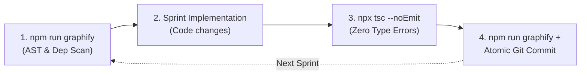

# Sprint Lifecycle & Feature Delivery Skill

## Purpose
Establishes a rigorous, repeatable Agile sprint engineering protocol for coding agents operating in the Blades Campaign Suite codebase. It formalizes:
1. **Sprint Plan Artifact Creation**: Decomposing features into clear topics, atomic sprints, and Mermaid architectural data flows.
2. **Per-Sprint Execution Cadence**: Maintaining code quality, zero type errors, and deterministic AST graph indexation via `graphify-ts`.
3. **Sprint Finish & Release Protocol**: Verifying production builds, authoring structured semantic release notes, merging to `main`, and presenting remote deployment steps.

---

## 1. Phase 1: Sprint Planning & Artifact Generation

When planning any non-trivial feature or overhaul:
1. Create a dedicated feature branch:
   ```bash
   git checkout -b feature/<descriptive-feature-name>
   ```
2. Author an **Antigravity Artifact** in the artifact directory (`<appDataDir>\brain\<conversation-id>\<feature_name>_plan.md`) conforming to the [Sprint Plan Template](file:///.agent/skills/sprint-lifecycle/templates/sprint_plan_template.md).

### Mandatory Artifact Structure
Every Sprint Plan Artifact MUST include:
* **Header & Scope**: Title, goal description, and designated feature branch.
* **Architecture & Data Flow Diagram**: A valid Mermaid diagram (`flowchart TD`, `sequenceDiagram`, or `erDiagram`) visualizing component interactions, state transitions, or database entity relationships.
* **Mandatory Cadence Callout**: A GitHub-style `> [!IMPORTANT]` block detailing the 4-step per-sprint loop.
* **Topic & Sprint Breakdown**:
  * Organized hierarchically: `Topic 1: Domain/Layer`, `Sprint 1.1`, `Sprint 1.2`, `Topic 2...`.
  * Each Sprint must explicitly declare:
    - `Focus`: 1-sentence summary of the sprint objective.
    - `Tasks`: Discrete, numbered implementation steps.
    - `Commit`: Expected atomic Conventional Commit message (`feat(...)`, `fix(...)`, `refactor(...)`, etc.).
* **Final Topic — Verification, Rules Fidelity & Documentation**:
  * Production build check (`npm run build`).
  * SRD rules fidelity audit against `.agent/knowledge/`.
  * Knowledge base & Graphify finalization.

---

## 2. Phase 2: Per-Sprint Execution Cadence

Agents must execute sprints sequentially using the **Strict 4-Step Sprint Loop**:



### Step 1 — Sprint Start (AST Indexation)
Before touching code, run Graphify to index existing dependencies, types, and AST structures:
```powershell
npm run graphify
```

### Step 2 — Sprint Implementation
- Implement the sprint's specific tasks cleanly and modularly.
- Maintain documentation integrity: preserve all unrelated comments and docstrings.
- Adhere strictly to the project's styling and SRD mechanics defined in `.agent/skills/` and `.agent/knowledge/`.

### Step 3 — Sprint Verification
Run TypeScript type-checking to ensure 0 errors:
```powershell
npx tsc --noEmit
```
*Never proceed to commit if `tsc` produces errors.* Fix all type inconsistencies before moving to Step 4.

### Step 4 — Sprint Commit
Re-run Graphify to synchronize AST graphs, stage files, and produce an atomic commit:
```powershell
npm run graphify
git add -A
git commit -m "<type>(<scope>): <concise description>"
```
Ensure `.graphify/` updates are included in the atomic commit or tracked alongside code changes.

---

## 3. Phase 3: Sprint Finish Protocol (Local Release & Validation)

Once all sprint topics are completed, execute the **Sprint Finish Protocol** locally before requesting user confirmation for remote push.

### Step 1 — Production Build Verification
Verify Next.js static production export succeeds with zero errors:
```powershell
npm run build
```

### Step 2 — Update Release Notes (`RELEASE_NOTES.md`)
Open [RELEASE_NOTES.md](file:///RELEASE_NOTES.md) and prepend a new release section following Semantic Versioning:
- **Version bump**:
  - `Patch` (`0.x.Y+1`): Minor bug fixes, cosmetic adjustments, or small refactors.
  - `Minor` (`0.X+1.0`): New user-facing features, new tables, or new interactive components.
  - `Major` (`1.0.0`): Breaking architectural rewrites or official release milestones.
- **Section Structure**:
  ```markdown
  ## [X.Y.Z] — YYYY-MM-DD

  ### <Emoji> <Feature Theme Title>

  <Narrative summary of feature impact and tabletop experience>

  #### 🌟 New Features & Enhancements
  * **Feature Name (`ComponentName.tsx`)**:
    * Detailed bullet points describing user and GM capabilities.

  #### 🗄️ Database & Schema (`supabase/migrations/...`)
  * Migration and RLS policy descriptions (if applicable).

  #### 📚 Knowledge & AST Indexation
  * Updates to `.agent/knowledge/` and `graphify-ts` node/edge counts.
  ```

### Step 3 — Knowledge Base Audit
Verify if rules, glossary terms, or faction mechanics require documentation updates in `.agent/knowledge/`.

### Step 4 — Final Feature Branch Commit
If `RELEASE_NOTES.md` or `.agent/knowledge/` were modified:
```powershell
npm run graphify
git add RELEASE_NOTES.md .agent/knowledge/ .graphify/
git commit -m "docs(release): update release notes and knowledge base for [X.Y.Z]"
```

### Step 5 — Merge Feature Branch into Main
Switch to `main` and perform a clean merge:
```powershell
git checkout main
git merge feature/<descriptive-feature-name>
```

### Step 6 — User Hand-Off for Remote Push & Deployment
Present the user with clear instructions and commands to push to GitHub remote and verify GitHub Pages:
```powershell
# Push main and feature branch to remote:
git push origin main
git push origin feature/<descriptive-feature-name>

# Monitor GitHub Pages deployment workflow:
gh run list --workflow=deploy.yml
gh run watch <run-id>
```

---

## 4. Integration with Agent Guidelines

When requested to plan a feature:
1. Consult this skill.
2. Generate the plan artifact from the template.
3. Prompt the user for review/feedback before executing Sprint 1.1.
