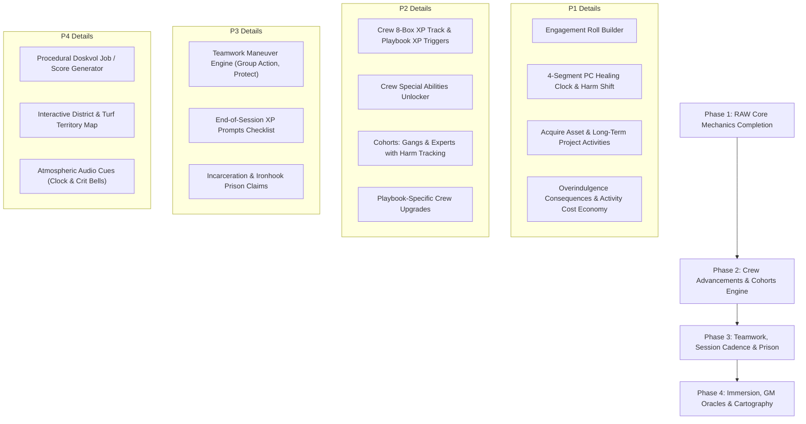

# Blades Campaign Suite — Rules-as-Written Audit & Implementation Roadmap

> **Document Status**: Active Master Roadmap  
> **Target Alignment**: Official *Blades in the Dark* System Reference Document (SRD)  
> **Persistence**: Tracked across sessions and sprints.

---

## 1. System Architecture & SRD Audit

| System / Mechanic | Blades SRD (RAW) Specification | Current Implementation | Status |
| :--- | :--- | :--- | :--- |
| **Dice Math Engine** | $\ge 1$ dot: roll $N$d, highest. $0$ dots: roll $2$d, lowest. Crit: two 6s. Resistance stress: $6 - \text{highest}$ (clear 1 on crit). | Implemented in [`src/lib/roller.ts`](file:///c:/Users/chri/Source/blades-campaign-suite-revamped/src/lib/roller.ts). | **Compliant** |
| **Stress & Trauma** | 0–9 Stress. 10th stress resets stress to 0 and adds 1 permanent Trauma condition. 4 traumas force retirement. | Implemented in [`StressBar.tsx`](file:///c:/Users/chri/Source/blades-campaign-suite-revamped/src/components/ui/StressBar.tsx) & [`CharacterSheet.tsx`](file:///c:/Users/chri/Source/blades-campaign-suite-revamped/src/components/character/CharacterSheet.tsx). | **Compliant** |
| **Desperate Action XP** | Desperate action rolls immediately award +1 XP to the rolled action's attribute track. | Automated in [`DiceRoller.tsx`](file:///c:/Users/chri/Source/blades-campaign-suite-revamped/src/components/roller/DiceRoller.tsx). | **Compliant** |
| **Linear Clocks** | 4, 6, 8, 12 segments; rendered as linear progress bars (never circular pie charts); GM secret vs public visibility. | Implemented in [`LinearClock.tsx`](file:///c:/Users/chri/Source/blades-campaign-suite-revamped/src/components/ui/LinearClock.tsx) & [`ClocksManager.tsx`](file:///c:/Users/chri/Source/blades-campaign-suite-revamped/src/components/campaign/ClocksManager.tsx). | **Compliant** |
| **Engagement Roll** | Formal pre-score fortune roll (1d luck base + plan detail, target vulnerability, contacts, tier differences) determining initial position. | Fully modeled in [`EngagementRollModal.tsx`](file:///c:/Users/chri/Source/blades-campaign-suite-revamped/src/components/roller/EngagementRollModal.tsx) and [`roller.ts`](file:///c:/Users/chri/Source/blades-campaign-suite-revamped/src/lib/roller.ts). | **Compliant** |
| **Recovery & Healing Clock** | 4-segment Healing clock on PC sheet. Downtime Recovery rolls Healer Quality/Tinker. When filled, all harm drops 1 level. | Modeled in [`HarmMatrix.tsx`](file:///c:/Users/chri/Source/blades-campaign-suite-revamped/src/components/ui/HarmMatrix.tsx), [`DowntimeWizard.tsx`](file:///c:/Users/chri/Source/blades-campaign-suite-revamped/src/components/downtime/DowntimeWizard.tsx), and [`downtime.ts`](file:///c:/Users/chri/Source/blades-campaign-suite-revamped/src/lib/downtime.ts). | **Compliant** |
| **Downtime Activities** | 6 canonical activities: *Vice, Reduce Heat, Train, Recover, Acquire Asset, Long-Term Project*. 2 free (or 1 at War); extras cost 1 Coin/Rep. | Fully implemented in [`DowntimeWizard.tsx`](file:///c:/Users/chri/Source/blades-campaign-suite-revamped/src/components/downtime/DowntimeWizard.tsx) and [`downtime.ts`](file:///c:/Users/chri/Source/blades-campaign-suite-revamped/src/lib/downtime.ts). | **Compliant** |
| **Crew XP & Advancements** | 8-box Crew XP track with playbook triggers. Marks unlock Crew Special Abilities or 2 Upgrades. | [`CrewSheet.tsx`](file:///c:/Users/chri/Source/blades-campaign-suite-revamped/src/components/campaign/CrewSheet.tsx) tracks Rep, Tier, and Hold, but **Crew XP is completely absent**. | **Missing (Phase 2)** |
| **Crew Special Abilities** | Each Crew playbook has unique special abilities that can be taken at advancement. | Abilities exist in constants, but **no interactive selector or activation UI** exists on the Crew sheet. | **Missing (Phase 2)** |
| **Cohorts (Gangs & Experts)** | Crews recruit Gangs or Experts with Quality (Tier), Scale, Edges (Fearsome, Loyal), Flaws (Savage, Unreliable), and Cohort Harm. | **Missing.** No Cohort models or UI exist in [`blades.ts`](file:///c:/Users/chri/Source/blades-campaign-suite-revamped/src/types/blades.ts) or [`CrewSheet.tsx`](file:///c:/Users/chri/Source/blades-campaign-suite-revamped/src/components/campaign/CrewSheet.tsx). | **Missing (Phase 2)** |
| **Teamwork Maneuvers** | 4 maneuvers: Assist (+1d / 1 stress), Lead Group Action (leader takes 1 stress per fail), Protect Teammate, Set Up (+1 effect/position). | Assist is an unlinked checkbox; Group Action, Protect, and Set Up have no tracking or sheet sync. | **Lacking (Phase 3)** |
| **End of Session XP** | Review 3 prompts (playbook trigger, beliefs/heritage, vice/trauma struggle) to award 1–2 XP each. | Scoundrel sheets track XP tracks, but lack the end-of-session prompt wizard. | **Lacking (Phase 3)** |
| **Incarceration Roll** | When Wanted Level hits 4 or a PC is arrested to purge Heat, roll Incarceration for prison claims, faction standing, and sentence. | Currently Wanted level rolls over, but has no incarceration event trigger or Ironhook sub-mechanic. | **Missing (Phase 3)** |

---

## 2. Competitive Ecosystem Comparison

```
┌────────────────────────────────────────────────────────────────────────────────────────┐
│                                 ECOSYSTEM BENCHMARK                                    │
├─────────────────────┬───────────────┬─────────────────┬────────────────┬───────────────┤
│ Feature             │ Blades Suite  │ Foundry VTT     │ Harper Sheets  │ Web Gens      │
│                     │ (This App)    │ (FitD Module)   │ (Google Docs)  │ (Perilous/Itch│
├─────────────────────┼───────────────┼─────────────────┼────────────────┼───────────────┤
│ Tech & Accessibility│ Web / Mobile  │ Heavy App / Host│ Cloud Sheet    │ Static Web    │
│ Theme & Immersion   │ High (Gothic) │ High (Module)   │ Low (Cells)    │ Moderate      │
│ Linear Clocks       │ Native Bar    │ Circular (Pie)  │ Manual cells   │ None          │
│ Multi-Campaign RLS  │ Native (Supab)│ Per-world db    │ Separate files │ None          │
│ Faction Turn Engine │ Automated Sim │ Macro-driven    │ Manual         │ None          │
│ NPC / Contact Web   │ 1-100 Affinity│ Simple Actor tab│ 2-box checkbox │ One-off gen   │
│ Cohort Tracking     │ Missing       │ Full Sheets     │ Basic table    │ None          │
│ Engagement Roller   │ Missing       │ Form Dialog     │ Manual roll    │ Step-by-step  │
│ Mission Generators  │ Missing       │ Roll tables     │ None           │ Rich tables   │
└─────────────────────┴───────────────┴─────────────────┴────────────────┴───────────────┘
```

---

## 3. Step-by-Step Phased Implementation Roadmap



---

## 4. Execution Checklists (Step-by-Step)

### Phase 1: RAW Core Mechanics Completion
*Goal: Close all deterministic divergences between the current app and official Blades SRD rules.*

- [x] **1.1 Engagement Roll Builder Modal**
  - [x] Create `src/components/roller/EngagementRollModal.tsx`.
  - [x] Add Operation Type selection: *Assault, Deception, Stealth, Occult, Social, Transport*.
  - [x] Add Plan Detail input (point of attack, method, infiltration route).
  - [x] Factor checklist: Bold/daring (+1d), target vulnerability (+1d), contact assistance (+1d), tier delta (+/-1d), security/fortified (-1d).
  - [x] Fortune roll resolution: Critical (through obstacle in Controlled), 6 (Controlled), 4/5 (Risky), 1-3 (Desperate).
  - [x] Direct export of engagement outcome into the main `DiceRoller` starting state.

- [x] **1.2 Scoundrel Recovery Engine & 4-Segment Healing Clock**
  - [x] Add `healing_clock: number` (0 to 4) to `Character` type and database schema.
  - [x] Render 4-segment linear Healing bar on [`CharacterSheet.tsx`](file:///c:/Users/chri/Source/blades-campaign-suite-revamped/src/components/character/CharacterSheet.tsx).
  - [x] Update `handleRecover` in [`DowntimeWizard.tsx`](file:///c:/Users/chri/Source/blades-campaign-suite-revamped/src/components/downtime/DowntimeWizard.tsx): roll Healer Quality / Tinker (1-3: 1 tick, 4/5: 2 ticks, 6: 3 ticks, Crit: 5 ticks).
  - [x] When the healing clock fills (4 segments): reset clock to 0 and shift all existing harm down by 1 level (Level 3 becomes Level 2, Level 2 becomes Level 1, Level 1 clears).

- [x] **1.3 Complete Downtime Activities (Acquire Asset & Long-Term Project)**
  - [x] Implement **Acquire Asset** step: rolls Crew Tier against asset quality table (1-3: Tier-1, 4/5: Tier, 6: Tier+1, Crit: Tier+2); option to spend 1 Coin to bump quality.
  - [x] Implement **Long-Term Project** step: select action, roll pool, tick selected campaign project clock (1, 2, 3, or 5 ticks).
  - [x] Track activity count against free allowance (2 activities, or 1 if Crew is at War).
  - [x] Automatically deduct 1 Coin (Purse) or 1 Rep per activity beyond the free limit.

- [x] **1.4 Vice Overindulgence Enforcer**
  - [x] Enforce overindulgence condition picker when `chosenDie > currentStress`:
    - *Attract Trouble*: +2 Heat to Crew.
    - *Brag*: +2 Heat to Crew.
    - *Lost*: Flag scoundrel as unavailable for 1 score.
    - *Tapped*: Mark vice purveyor inactive.

---

### Phase 2: Crew Advancements & Cohorts Engine
*Goal: Turn the Crew Sheet into a full operational hub with cohorts and playbook progressions.*

- [ ] **2.1 Crew XP Track & Playbook XP Triggers**
  - [ ] Add `xp: number` (0 to 8) to `Crew` interface and Supabase schema.
  - [ ] Render 8-segment linear Crew XP bar with advancement trigger checklist:
    - *Assassins*: Successful assassination, extortion, or dark operation.
    - *Bravos*: Successful robbery, extortion, or sabotage.
    - *Cult*: Consecrated ground, esoteric artifact, or sacrificial offering.
    - *Hawkers*: Contraband acquisition, new sales territory, or sales volume.
    - *Shadows*: Successful burglary, espionage, or robbery.
    - *Smugglers*: Successful smuggling operation or contraband route.
  - [ ] Trigger advance modal when 8 XP is reached: choose 1 Crew Special Ability or 2 Crew Upgrades.

- [ ] **2.2 Crew Special Abilities Interactive Selector**
  - [ ] Build interactive ability toggle matrix on [`CrewSheet.tsx`](file:///c:/Users/chri/Source/blades-campaign-suite-revamped/src/components/campaign/CrewSheet.tsx).
  - [ ] Support playbook specific abilities + Veteran ability picks from other crew playbooks.

- [ ] **2.3 Cohorts System (Gangs & Experts)**
  - [ ] Define `Cohort` interface: `id`, `crew_id`, `name`, `kind: 'gang' | 'expert'`, `quality: number`, `scale: number`, `edges: string[]`, `flaws: string[]`, `harm: 'healthy' | 'impaired' | 'broken'`, `armor: boolean`.
  - [ ] Create `CohortCard.tsx` in `src/components/campaign/`.
  - [ ] Roll Cohort Quality rolls directly from the crew view.

- [ ] **2.4 Playbook-Specific Crew Upgrades**
  - [ ] Expand upgrade matrix from generic list to playbook-specific items (e.g. Smugglers: Camouflage, Hidden Cargo; Bravos: Iron Gate, Barracks).

---

### Phase 3: Teamwork, Session Cadence & Prison
*Goal: Facilitate group play mechanics and long-term narrative consequences.*

- [ ] **3.1 Teamwork Maneuver Engine**
  - [ ] **Lead a Group Action**: GM selects participating scoundrels; rolls all pools simultaneously; leader automatically incurs 1 stress per participant who rolled 1–3.
  - [ ] **Protect a Teammate**: Prompts a resistance roll to absorb or negate an ally's consequence.
  - [ ] **Setup Action**: Grants next player +1 effect or +1 position level on success.

- [ ] **3.2 End-of-Session XP Wizard**
  - [ ] Interactive modal guiding scoundrels through the 3 end-of-session questions:
    - *Did you express your beliefs, drives, heritage, or background?*
    - *Did you struggle with issues from your vice or traumas?*
    - *Did you address challenges with your playbook-specific style?*
  - [ ] Allocate 1 or 2 XP to playbook or attribute tracks upon submission.

- [ ] **3.3 Incarceration & Ironhook Prison Subsystem**
  - [ ] Incarceration roll upon hitting Wanted Level 4 or serving time to clear Heat.
  - [ ] Incarceration outcomes: prison claims, prison faction status, and sentence length.

---

### Phase 4: Immersion, GM Oracles & Cartography
*Goal: Provide GM tools and rich world-building assets.*

- [ ] **4.1 Procedural Doskvol Job / Score Generator**
  - [ ] Client, Target, Work, Twist, and Connected Faction generator from SRD tables.
  - [ ] One-click export into `JournalLedger` as an active Score entry.

- [ ] **4.2 Interactive Doskvol District & Turf Territory Map**
  - [ ] Interactive map with district overlays (Crow's Foot, Docks, Silkshore, etc.).
  - [ ] Displays Crew Lair, Hunting Grounds, Claims, and Faction territory markers.

- [ ] **4.3 Atmospheric Audio Cues (Optional)**
  - [ ] Subtle sound bites on Clock completion, Trauma infliction, and Critical rolls.
